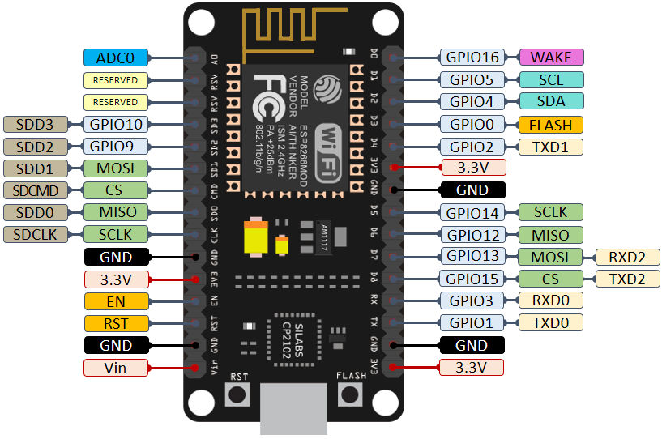
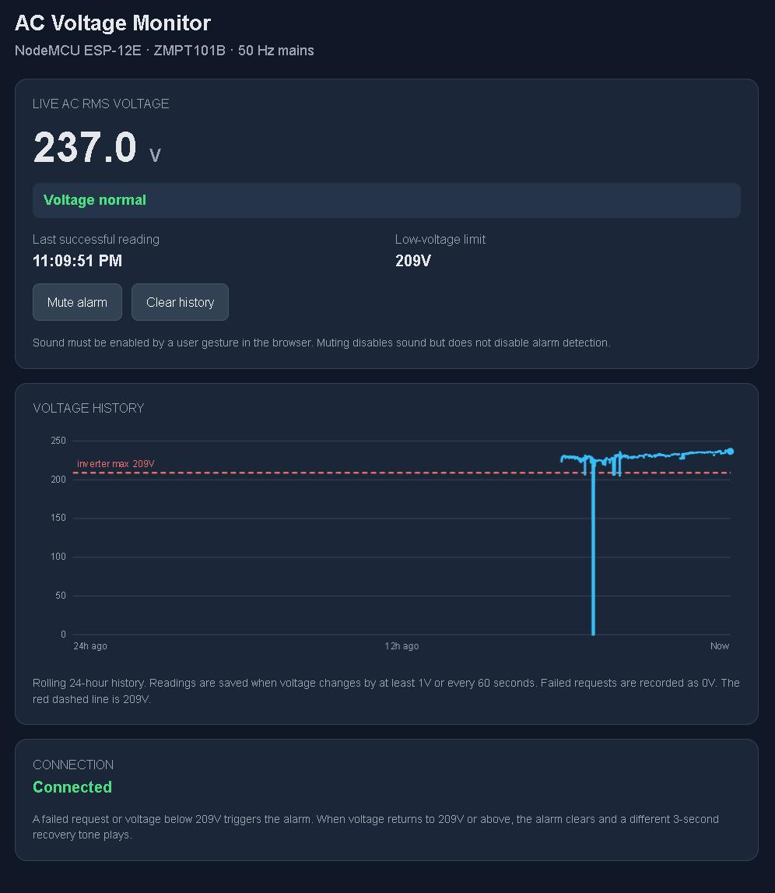

# ac-voltage-meter-server

Monitor AC voltage using ZMPT101B sensor and host web server to track it in a browser using 24 hour chart.

Warning: This involves AC voltage. Make sure to insulate high voltage connections well before turning on the power.

## Hardware

1. ZMPT101B AC voltage sensor
  
2. NodeMCU ESP12E
  
3. A 5 volt power supply
4. A box to put things in

## Software

1. Arduino IDE
2. USB driver installed for the USB module on the ESP dev board
3. Web browser

## Connections

| ESP 12E pin | Connect to |
|--|--|
| ADC0 | ZMPT101B Out pin |
| 3.3V | ZMPT101B Vcc pin |
| GND  | ZMPT101B Gnd pin |
| Vin  | Positive (+) wire of power supply |
| GND  | Negative (-) wire of power supply |

## Setup

After soldering the components, make sure the ESP module reads clean sine wave from the voltage sensor. Run the following code first and see the output in Serial Plotter of Arduino IDE.

```cpp
void setup() {
  Serial.begin(115200);
}

void loop() {
  Serial.println(analogRead(A0));
  delayMicroseconds(500);
}
```

Read the [ac_voltage_meter_server.ino](src/ac_voltage_meter_server.ino) and update values as per your setup.

Deploy the code to the ESP. And in the IDE's Serial Monitor look at the logs you'll see something like:

```text
Connected. IP address: 192.168.0.24
HTTP server started
```

Give static IP to the ESP module on your router.

To monitor the voltage open URL `http://192.168.0.24` in any web browser on computer. You'll see the screen like the following:



The web client polls the server every two seconds and reads voltage using `http://192.168.0.24/voltage?t=1793190476280` URL. The voltage data is stored in the websites's local storage in the browser. The graph doesn't record consecutive same voltages.

Also, there is a threshold voltage set in the code in `LOW_LIMIT` variable. It is the voltage supplied by backup inverter when main power is out. When voltage goes below it the web page sounds continuous alarm. Change the value as per your inverter voltage.

There is also `http://192.168.0.24/v` URL which returns raw voltage value.

## OTA deployment

The code has the [ElegantOTA](https://github.com/ayushsharma82/ElegantOTA) over-the-air(OTA) firmware deployment in place. So after the first programming you don't need to connect the ESP12E module to your computer every time you tweak the code. In Arduino IDE use menu `Sketch -> Export compiled binary` to generate `.bin` file. It'll be generated in a folder near the `.ino` file. Then open `http://192.168.0.24/update` URL in a browser and upload the binary file.
